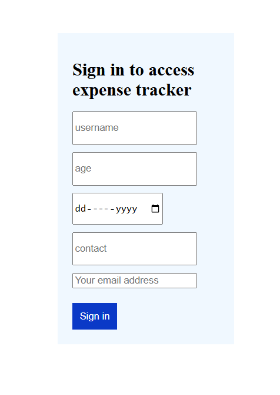
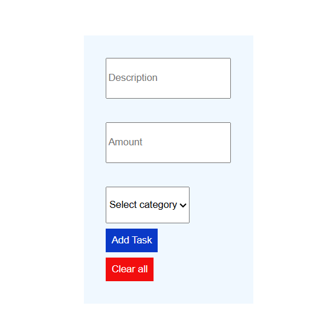

# Track Expense

# About the project
This is a simple expense Tracker where a user can add the expenses and even choose the category.

# Technologies used
HTML
CSS
JAVASCRIPT

# How it works
The project has a landing page with the sign in form where a users signs in.He is redirected to the expense page where he is able to access the expense tracker.On the expense tracker he is able to add and clear expenses.

The home page has cookies ,local storage and page redirection 
The expense page has oop with where you can add an expense and clear an expense.

# images
 //this is a sign in form for a landing page

 //this is an expense tracker
# Author
Brian Obare

